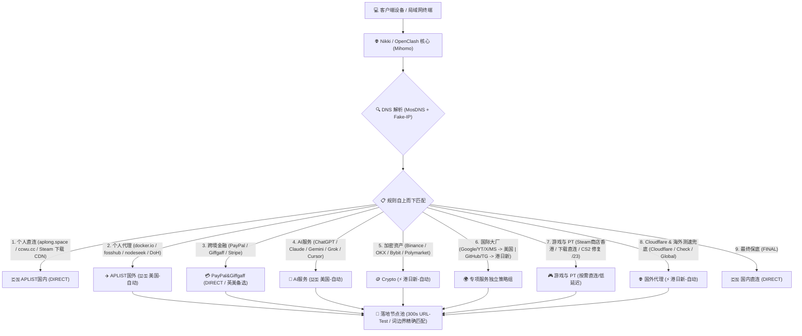

# ⚡ ApClash - 现代化 Nikki (Mihomo) / OpenClash 优雅分流配置

<p align="center">
  
</p>

<p align="center">
  <a href="https://github.com/Apocalypse-Long/clash/actions/workflows/lint.yml"></a>
  <a href="https://opensource.org/licenses/MIT"></a>
  <a href="https://github.com/MetaCubeX/mihomo"></a>
  <a href="https://www.jsdelivr.com/"></a>
</p>

专为 **ImmortalWrt Nikki (Mihomo)**、**OpenClash**、**Clash Verge Rev** 以及 **FlClash** 深度调优的现代化分流规则库与 Subconverter 远程转换配置，也是 **ApWall 分布式集群** 订阅编译流水线的上游规则单一可信源。

---

## 🏗️ 流量调度架构图



---

## 🌟 核心策略分流表

> 按 `apclash.ini` 实际规则匹配优先级自上而下排列（`Cloudflare.list` 已下移至专项服务之后、`🌐 国外代理` 之前，防止其 Anycast IP 段抢占下游业务分流）：

| 策略分流组 | 默认首选策略 | 备选策略池 | 分流范围与优化特性 |
| :--- | :--- | :--- | :--- |
| **🇨🇳 APLIST国内** | `DIRECT` | ⚡ 港日新-自动、所有-自动、手动、REJECT | 私有/集群域名 (`aplong.space`, `ccwu.cc`, `090227.xyz` 防回环)、国内 PT、**Steam 游戏下载国内 CDN** |
| **✈️ APLIST国外** | `🇺🇸 美国-自动` | ⚡ 港日新-自动、所有-自动、香港、日本、新加坡、英国、手动、DIRECT | 开发者镜像 (`docker.io`, `armbian`)、海外社区 (`nodeseek`)、公共 DoH 与下游 Cloudflare 兜底 |
| **💳 PayPal&Giffgaff** | `DIRECT` | 🇬🇧 英国-自动、🇺🇸 美国-自动、🇸🇬 新加坡-自动、手动、REJECT | PayPal、Giffgaff 及 Stripe (`stripe.com` / `stripe.network` / `stripecdn.com`) 防跨区风控 |
| **🤖 AI服务** | `🇺🇸 美国-自动` | 🇬🇧 英国、🇸🇬 新加坡、🇯🇵 日本、所有-自动、手动、DIRECT | ChatGPT、Sora、Claude、Gemini、NotebookLM、Grok (`x.ai`)、Cursor、Windsurf、OpenRouter（已剥离 `x.com`、`cn.bing.com` 与 `stripe.com` 误捕） |
| **🪙 Crypto** | `⚡ 港日新-自动` | 新加坡、日本、香港、所有-自动、手动、DIRECT | Binance、OKX、Bybit、Bitget、Coinbase、Polymarket、MetaMask、TradingView |
| **🐙 GitHub** | `⚡ 港日新-自动` | 香港、日本、新加坡、美国、所有-自动、手动、DIRECT | Git 克隆、Releases 下载、Web 页面秒开 |
| **🎵 TikTok** | `DIRECT` | 🇺🇸 美国-自动、🇬🇧 英国、🇯🇵 日本、🇸🇬 新加坡、🇭🇰 香港、手动 | 默认直连保护防锁区，按需手动切换海外代理 |
| **✈️ Telegram** | `⚡ 港日新-自动` | 香港、新加坡、日本、所有-自动、手动、DIRECT | 电报群组、多媒体文件快速传输 |
| **🐦 Twitter(X)** | `🇺🇸 美国-自动` | ⚡ 港日新-自动、香港、日本、所有-自动、手动、DIRECT | `x.com` / `twitter.com` 信息流与图床视频完整归口（不再被 AI 规则截胡） |
| **📘 Facebook** | `⚡ 港日新-自动` | 香港、日本、美国、所有-自动、手动、DIRECT | Meta 社交资讯与跨国社交平台 |
| **📦 Amazon** | `⚡ 港日新-自动` | 香港、日本、美国、所有-自动、手动、DIRECT | 跨境电商购物与海外 AWS 相关资产 |
| **🍎 Apple** | `DIRECT` | ⚡ 港日新-自动、香港、日本、美国、手动 | App Store、iCloud、Apple Music 国内直连满速 |
| **🪟 Microsoft** | `🇺🇸 美国-自动` | DIRECT、⚡ 港日新-自动、香港、日本、手动 | Windows、Office 365 与国际版账号服务 |
| **🔍 Google** | `🇺🇸 美国-自动` | ⚡ 港日新-自动、香港、日本、新加坡、所有-自动、手动、DIRECT | Google 搜索、Play 商店、API 服务 |
| **📺 YouTube** | `🇺🇸 美国-自动` | ⚡ 港日新-自动、香港、日本、新加坡、所有-自动、手动、DIRECT | YouTube 4K 超高清低延迟视频流 |
| **🎧 Spotify** | `⚡ 港日新-自动` | 香港、日本、美国、所有-自动、手动、DIRECT | 音乐流媒体播放与多平台同步 |
| **🎮 Steam** | `🇭🇰 香港-自动` | DIRECT、⚡ 港日新-自动、日本、新加坡、美国、手动 | 商店/社区走低延迟香港，游戏下载 CDN 已分流至 `🇨🇳 APLIST国内` 直连满速，CS2 修复 `/23` 掩码 |
| **🕹️ EA Game** | `DIRECT` | ⚡ 港日新-自动、香港、日本、新加坡、美国、手动 | EA App / Origin 游戏平台鉴权 |
| **📥 PT站** | `DIRECT` | 所有-自动、手动、REJECT | 严防公网代理下载导致账号封禁 |
| **🌐 国外代理** | `⚡ 港日新-自动` | 所有-自动、香港、日本、新加坡、美国、英国、手动、DIRECT | **【全网海外兜底】** 详细分流未命中时的通用海外出口（含海外 `check.list` 检测） |
| **🇨🇳 国内直连** | `DIRECT` | 国外代理、所有-自动 | **【最终直连保底】** 全局未匹配流量终极直连 |

---

## ⚡ 节点测试组正则机制 (URL-Test)

所有自动测速组基于 `https://www.gstatic.com/generate_204` 进行定期探测（周期 **`300s`**，容差 **`50ms`**，超时 `100ms`），并启用 **英文词边界防护**（防止 `AUSTRALIA`/`RUSSIA` 误匹配 `US`、`FUKUOKA` 误匹配 `UK`、`NODE` 误匹配 `DE`）与 **机场信息伪节点剔除**：

- **`🖐️ 所有-手动` & `⚡ 所有-自动`**：自动排除 `剩余|流量|到期|官网|套餐|重置|群组|频道|失联|备用网址` 等提示节点。
- **`⚡ 港日新-自动`**：优先汇聚亚洲低延迟节点（香港、日本、新加坡）。
- **`🇭🇰 香港-自动`**：`香港|HK|HKG|Hong Kong|🇭🇰`（词边界匹配）
- **`🇯🇵 日本-自动`**：`日本|大阪|东京|JP|JPN|TYO|NRT|KIX|Japan|Tokyo|Osaka|🇯🇵`（词边界匹配）
- **`🇸🇬 新加坡-自动`**：`新加坡|狮城|SG|SGP|SIN|Singapore|🇸🇬`（词边界匹配）
- **`🇹🇼 台湾-自动`**：`台湾|台北|TW|TWN|TPE|Taiwan|Taipei|🇹🇼`（词边界匹配）
- **`🇺🇸 美国-自动`**：`美国|洛杉矶|西雅图|圣何塞|硅谷|芝加哥|纽约|US|USA|LAX|SJC|SEA|ORD|EWR|IAD|United States|America|🇺🇸`（词边界匹配）
- **`🇬🇧 英国-自动`**：`英国|伦敦|UK|GBR|LHR|United Kingdom|Great Britain|🇬🇧`（词边界匹配）
- **`🇩🇪 德国-自动`**：`德国|法兰克福|DE|DEU|FRA|Germany|Deutschland|🇩🇪`（词边界匹配）
- **`🌐 其他-自动`**：排除伪节点及上述国家/地区关键词后的兜底节点。

---

## 🚀 极速上手配置

### 1. ImmortalWrt 25.12 (`Nikki / Mihomo` + `MosDNS`) 与 ApWall 接入

针对运行 **ImmortalWrt 25.12 + Nikki (Mihomo) + MosDNS** 的主路由架构：
- **ApWall 边缘双活订阅中枢** 每 3 天定时拉取本仓库 `apclash.ini` 并渲染全量 32 组配置（无物理节点的地区自动降级为 `select -> DIRECT` 防止空组报错）。
- 如需直接在 Nikki 或通用订阅转换中使用本仓库规则模板，填入下方 CDN 链接即可；同时 `rules/custom-direct.list` 已包含 `ccwu.cc`、`090227.xyz` 与 `aplong.space`，与路由器本地 MosDNS 直连表保持零冲突。

### 2. OpenClash 订阅配置

1. 进入路由器后台：**服务** -> **OpenClash** -> **配置订阅**。
2. 点击 **添加**，填入你的机场订阅 URL 并勾选 **在线订阅转换**。
3. 在 **转换模板** 中选择 **自定义模板**，填入以下推荐 CDN 模板地址：

> [!TIP]
> **推荐 CDN 链接（国内直连访问速度快、防屏蔽、实时同步）：**
> ```text
> https://fastly.jsdelivr.net/gh/Apocalypse-Long/clash@main/apclash.ini
> ```

#### 模板地址对比表

| 模板版本 | 推荐 CDN 加速源 (无代理亦可秒拉取) | GitHub 官方源 (需要当前外网顺畅) |
| :--- | :--- | :--- |
| **旗舰完整版 (`apclash.ini`)** | `https://fastly.jsdelivr.net/gh/Apocalypse-Long/clash@main/apclash.ini` | `https://raw.githubusercontent.com/Apocalypse-Long/clash/main/apclash.ini` |
| **极速轻量版 (`aplite.ini`)** | `https://fastly.jsdelivr.net/gh/Apocalypse-Long/clash@main/aplite.ini` | `https://raw.githubusercontent.com/Apocalypse-Long/clash/main/aplite.ini` |
| **历史存档版 (`archive/oldclash.ini`)** | `https://fastly.jsdelivr.net/gh/Apocalypse-Long/clash@main/archive/oldclash.ini` | `https://raw.githubusercontent.com/Apocalypse-Long/clash/main/archive/oldclash.ini` |

### 3. 在线 Subconverter 一键订阅转换链接生成

适用于 **FlClash**、**Clash Verge Rev** 或远程配置文件生成：

```text
https://api.v1.mk/sub?target=clash&url=【替换为你的机场订阅】&insert=false&config=https%3A%2F%2Ffastly.jsdelivr.net%2Fgh%2FApocalypse-Long%2Fclash%40main%2Fapclash.ini&emoji=true&list=false&udp=true&tfo=false&scv=false&fdn=false&sort=false
```

#### 常用稳定 Subconverter 后端推荐
- `https://api.wcc.best/sub` (速度快，抗压强，推荐)
- `https://api.v1.mk/sub` (老牌知名后端)
- `https://sub.xeton.dev/sub`
- `https://sub.id9.cc/sub`

### 4. OpenClash 开发者选项防火墙脚本 (安全原子注入)

仓库提供了经过加固的 [`openclash/custom-firewall.sh`](file:///C:/Users/13708/.gemini/antigravity/scratch/clash/openclash/custom-firewall.sh)：
- 2 天本地缓存保护，减少无谓下载与闪存/磁盘操作。
- 使用 `curl -fsSL` 下载至临时文件，校验包含有效 `address=/` 记录后原子替换，避免远端 502 页面写坏 Dnsmasq 导致断网。

---

## 🛠️ 自定义规则添加指南

本项目所有规则均已解耦并存放在 [`rules/`](file:///C:/Users/13708/.gemini/antigravity/scratch/clash/rules) 目录下：

```text
rules/
├── custom-direct.list    # 个人国内直连白名单 (含自建域名防回环与 Steam 下载 CDN)
├── custom-proxy.list     # 个人国外代理黑名单 (开源镜像 / 海外社区 / DoH)
├── ai.list               # 综合 AI 服务名单 (2025-2026 高纯净版)
├── gaming.list           # 游戏平台与联机 IP-CIDR (含 CS2 修复 /23 掩码)
├── crypto.list           # 加密货币交易与钱包名单
└── check.list            # 海外 IP 归属、DNS 泄露与速度检测工具
```

> [!NOTE]
> 提交修改到 GitHub 后，CI 会自动校验语法、重复行、跨列表直连/代理冲突与危险子网掩码；由于 CDN 具备缓存机制，如需立即生效可在订阅转换时临时使用 GitHub 原始链接或等待 CDN 刷新。

---

## 🎨 Zashboard 控制面板定制

仓库内置了个性化 WebUI 配置 [`zashboard/zashboard.json`](file:///C:/Users/13708/.gemini/antigravity/scratch/clash/zashboard/zashboard.json) 与三张高清背景壁纸 (`bg1.jpeg` ~ `bg3.jpeg`)：
- 预设翡翠绿 / 极光暗色主题，优化节点卡片宽度（155px）与拓扑图展示。

---

## 🛡️ 持续集成与质量保证 (CI)

本仓库拥有全链路 GitHub Actions 自动化校验门禁 [`lint.yml`](file:///C:/Users/13708/.gemini/antigravity/scratch/clash/.github/workflows/lint.yml)：
- **规则语法与 `no-resolve` 门禁**：精确校验规则前缀，强制所有 IP/ASN 规则携带 `no-resolve`。
- **CIDR 严格防爆拦截**：利用 `ipaddress` 严格校验网络位，拦截 IPv4 `< /8` 与 IPv6 `< /32` 的危险大网段以及主机位未归零条目。
- **零冲突与去重检查**：拦截同文件重复规则，并检查 `custom-direct.list` 与各代理列表的跨文件冲突。
- **双份配置一致性与正则单测**：校验 `apclash.ini` ↔ `profiles/apclash-full.ini`、`aplite.ini` ↔ `profiles/apclash-lite.ini` 字节完全一致，并针对 ApWall 节点名与常见边界样本（`AUSTRALIA`、`FUKUOKA`、`剩余流量` 等）运行正则单元测试。

---

## 🤝 致谢与上游开源项目

- [Mihomo (Clash.Meta)](https://github.com/MetaCubeX/mihomo) - 强大的核心分流引擎
- [Nikki](https://github.com/nikkinikki-org/OpenWrt-nikki) / [OpenClash](https://github.com/vernesong/OpenClash) - 顶级的 OpenWrt / ImmortalWrt 透明代理客户端
- [blackmatrix7/ios_rule_script](https://github.com/blackmatrix7/ios_rule_script) - 全网权威的规则数据源
- [Subconverter](https://github.com/tindy2013/subconverter) - 优雅强大的订阅转换工具
