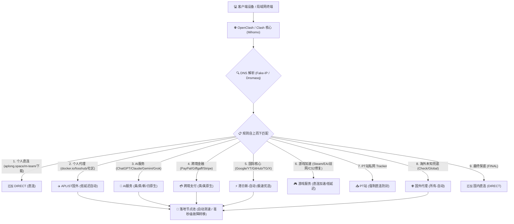

# ⚡ ApClash - 现代化 OpenClash / Clash Meta 优雅分流配置

<p align="center">
  
</p>

<p align="center">
  <a href="https://github.com/Apocalypse-Long/clash/actions/workflows/lint.yml"></a>
  <a href="https://opensource.org/licenses/MIT"></a>
  <a href="https://github.com/MetaCubeX/mihomo"></a>
  <a href="https://www.jsdelivr.com/"></a>
</p>

专为 **OpenClash (软路由)**、**Clash Verge Rev**、**FlClash** 以及 **Mihomo (Clash.Meta)** 深度调优的现代化分流规则库与 Subconverter 远程转换配置。

---

## 🏗️ 流量调度架构图



---

## 🌟 核心策略分流表

| 策略分流组 | 默认首选策略 | 备选策略池 | 分流范围与优化特性 |
| :--- | :--- | :--- | :--- |
| **🇨🇳 APLIST国内** | `DIRECT` | ⚡ 港日新-自动、所有-自动、手动、REJECT | 私有域名 (`aplong.space`)、国内 PT、企业办公服务 |
| **✈️ APLIST国外** | `⚡ 港日新-自动` | 所有-自动、香港、日本、新加坡、美国、英国、手动 | 开发者镜像 (`docker.io`, `armbian`)、海外小众站点 |
| **🤖 AI服务** | `🇺🇸 美国-自动` | 🇬🇧 英国、🇸🇬 新加坡、🇯🇵 日本、所有-自动、手动 | ChatGPT、Claude、Gemini、Grok、Perplexity、Cursor (避开不合规地区) |
| **💳 跨境支付** | `DIRECT` | 🇬🇧 英国-自动、🇺🇸 美国-自动、🇸🇬 新加坡-自动、手动 | PayPal、Giffgaff、Stripe 防风控封号 |
| **🎵 TikTok** | `🇺🇸 美国-自动` | 🇬🇧 英国、🇯🇵 日本、🇸🇬 新加坡、🇭🇰 香港、手动 | 规避区域检测，智能流媒体解锁 |
| **🔍 Google** | `⚡ 港日新-自动` | 香港、日本、新加坡、美国、所有-自动、手动 | Google 搜索、Play 商店、API 服务 |
| **📺 YouTube** | `⚡ 港日新-自动` | 香港、日本、新加坡、美国、所有-自动、手动 | YouTube 4K 超高清低延迟视频流 |
| **🐙 GitHub** | `⚡ 港日新-自动` | 香港、日本、新加坡、美国、所有-自动、手动 | Git 克隆、Releases 下载、Web 页面秒开 |
| **✈️ Telegram** | `⚡ 港日新-自动` | 香港、新加坡、日本、所有-自动、手动 | 电报群组、多媒体文件快速传输 |
| **🐦 Twitter(X)** | `⚡ 港日新-自动` | 香港、日本、美国、所有-自动、手动 | 信息流无缝刷新与视频缓冲 |
| **🪙 Crypto** | `⚡ 港日新-自动` | 新加坡、日本、香港、所有-自动、手动 | 币安、OKX、Bybit、Web3 钱包合规链路 |
| **🍎 Apple** | `DIRECT` | ⚡ 港日新-自动、香港、日本、美国、手动 | App Store、Apple Music 国内直连满速 |
| **🪟 Microsoft** | `DIRECT` | ⚡ 港日新-自动、香港、日本、美国、手动 | Windows Update、Office 365 直连低延迟 |
| **🎮 Steam** | `DIRECT` | ⚡ 港日新-自动、香港、日本、新加坡、美国、手动 | 商店走代理，CDN 下载走国内满速节点 |
| **📥 PT站** | `DIRECT` | 所有-自动、手动、REJECT | 严防公网代理下载导致账号封禁 |
| **🌐 国外代理** | `⚡ 港日新-自动` | 所有-自动、香港、日本、新加坡、美国、英国、手动 | 兜底未收录的海外网站与全网测速工具 |
| **🇨🇳 国内直连** | `DIRECT` | 国外代理、所有-自动 | 大陆常规流量白名单直连 |

---

## ⚡ 节点测试组正则机制 (URL-Test)

所有自动节点基于 `https://www.gstatic.com/generate_204` 进行低容差探测（周期 `180s`，容差 `50ms`）：

- **`⚡ 港日新-自动`**：优先汇聚亚洲低延迟节点（香港、日本、新加坡），延迟低、稳定性强。
- **`🇭🇰 香港-自动`**：`(香港|HK|Hong Kong|HongKong|🇭🇰)`
- **`🇯🇵 日本-自动`**：`(日本|JP|Japan|Tokyo|Osaka|🇯🇵)`
- **`🇸🇬 新加坡-自动`**：`(新加坡|SG|Singapore|Lion|🇸🇬)`
- **`🇹🇼 台湾-自动`**：`(台湾|TW|Taiwan|Taipei|🇹🇼)`
- **`🇺🇸 美国-自动`**：`(美国|US|United States|America|美|🇺🇸)`
- **`🇬🇧 英国-自动`**：`(英国|UK|United Kingdom|Great Britain|英|🇬🇧)`
- **`🇩🇪 德国-自动`**：`(德国|DE|Germany|Deutschland|德|🇩🇪)`
- **`🌐 其他-自动`**：精准排除上述国家关键词后的兜底冷门节点。

---

## 🚀 极速上手配置

### 1. OpenClash 订阅配置 (主路由 / 旁路由推荐)

1. 进入路由器后台：**服务** -> **OpenClash** -> **配置订阅**。
2. 点击 **添加**，填入你的机场订阅 URL。
3. 勾选 **在线订阅转换**。
4. 在 **转换模板** 中选择 **自定义模板**，填入以下推荐 CDN 模板地址：

> [!TIP]
> **推荐 CDN 链接（国内直连访问速度快、防屏蔽、实时同步）：**
> ```text
> https://fastly.jsdelivr.net/gh/Apocalypse-Long/clash@main/apclash.ini
> ```

#### 模板地址对比表

| 模板版本 | 推荐 CDN 加速源 (无代理亦可秒拉取) | GitHub 官方源 (需要当前外网顺畅) |
| :--- | :--- | :--- |
| **旗舰完整版 (`apclash.ini`)** | `https://fastly.jsdelivr.net/gh/Apocalypse-Long/clash@main/apclash.ini` | `https://raw.githubusercontent.com/Apocalypse-Long/clash/main/apclash.ini` |
| **极速轻量版 (`aplite.ini`)** | `https://fastly.jsdelivr.net/gh/Apocalypse-Long/clash@main/aplite.ini` | `https://raw.githubusercontent.com/Apocalypse-Long/clash/main/aplite.ini` |

5. 转换服务选择公共后端（如 `https://api.wcc.best/sub` 或 `https://api.v1.mk/sub`）。
6. 点击 **保存配置** 并 **更新配置** 即可！

---

### 2. 在线 Subconverter 一键订阅转换链接生成

适用于 **FlClash**、**Clash Verge Rev** 或远程配置文件生成：

```text
https://api.v1.mk/sub?target=clash&url=【替换为你的机场订阅】&insert=false&config=https%3A%2F%2Ffastly.jsdelivr.net%2Fgh%2FApocalypse-Long%2Fclash%40main%2Fapclash.ini&emoji=true&list=false&udp=true&tfo=false&scv=false&fdn=false&sort=false
```

#### 常用稳定 Subconverter 后端推荐
- `https://api.wcc.best/sub` (速度快，抗压强，推荐)
- `https://api.v1.mk/sub` (老牌知名后端)
- `https://sub.xeton.dev/sub`
- `https://sub.id9.cc/sub`

---

### 3. OpenClash 开发者选项防火墙脚本 (去广告 & 自动重载)

仓库提供了 [`openclash/custom-firewall.sh`](file:///C:/Users/13708/.gemini/antigravity/scratch/clash/openclash/custom-firewall.sh)：
- 自动拉取 anti-AD 过滤规则并注入至本地 Dnsmasq
- 自动重载并清理 DNS 缓存

**配置步骤：**
1. 复制 [`openclash/custom-firewall.sh`](file:///C:/Users/13708/.gemini/antigravity/scratch/clash/openclash/custom-firewall.sh) 内全部内容。
2. 打开 OpenClash 插件设置 -> **开发者选项**，粘贴并保存应用。

---

## 🛠️ 自定义规则添加指南

本项目所有规则均已解耦并存放在 [`rules/`](file:///C:/Users/13708/.gemini/antigravity/scratch/clash/rules) 目录下：

```text
rules/
├── custom-direct.list    # 个人国内直连白名单
├── custom-proxy.list     # 个人国外代理黑名单
├── ai.list               # 综合 AI 服务名单
├── gaming.list           # 游戏平台及对局服务器 (修复 CS2 CIDR)
├── crypto.list           # 加密货币交易与钱包名单
└── check.list            # 节点检测与测速工具
```

### 添加国内直连域名 (例如内网穿透、私人NAS、公司内网)
打开 [`rules/custom-direct.list`](file:///C:/Users/13708/.gemini/antigravity/scratch/clash/rules/custom-direct.list)，追加一行：
```ini
DOMAIN-SUFFIX,nas.yourdomain.com
DOMAIN,office.internal.net
```

### 添加国外代理域名 (例如特定开源社区、海外自建节点)
打开 [`rules/custom-proxy.list`](file:///C:/Users/13708/.gemini/antigravity/scratch/clash/rules/custom-proxy.list)，追加一行：
```ini
DOMAIN-SUFFIX,new-overseas-tech.io
```

> [!NOTE]
> 提交修改到 GitHub 后，由于 CDN 具备缓存机制，如需立即生效可在订阅转换时临时使用 GitHub 原始链接，或等待 CDN 自动更新缓存。

---

## 🎨 Zashboard 控制面板定制

仓库内置了个性化 WebUI 配置 [`zashboard/zashboard.json`](file:///C:/Users/13708/.gemini/antigravity/scratch/clash/zashboard/zashboard.json) 与三张高清背景壁纸：
- 预设翡翠绿 / 极光暗色主题。
- 优化了节点卡片宽度（155px）与拓扑图展示。
- 可在 Zashboard 网页设置中一键导入配置生效。

---

## 🛡️ 持续集成与质量保证 (CI)

本仓库拥有完善的 GitHub Actions 自动化校验机制 [`lint.yml`](file:///C:/Users/13708/.gemini/antigravity/scratch/clash/.github/workflows/lint.yml)：
- 每次代码 Push 或 PR 时，自动检测所有规则文件语法合法性。
- 严格拦截危险的广域子网掩码（如掩码 `/2`、`/0` 等），保障路由系统稳定运行。

---

## 🤝 致谢与上游开源项目

- [Mihomo (Clash.Meta)](https://github.com/MetaCubeX/mihomo) - 强大的核心分流引擎
- [OpenClash](https://github.com/vernesong/OpenClash) - 顶级的 OpenWrt 客户端
- [blackmatrix7/ios_rule_script](https://github.com/blackmatrix7/ios_rule_script) - 全网权威的规则数据源
- [Subconverter](https://github.com/tindy2013/subconverter) - 优雅强大的订阅转换工具
